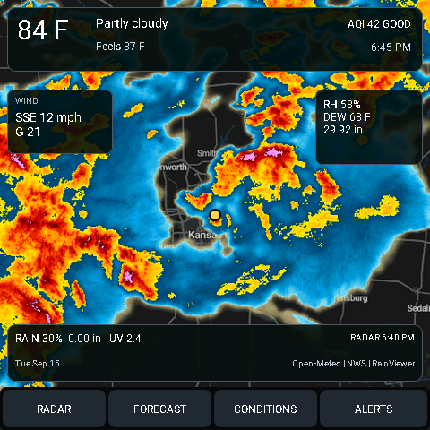
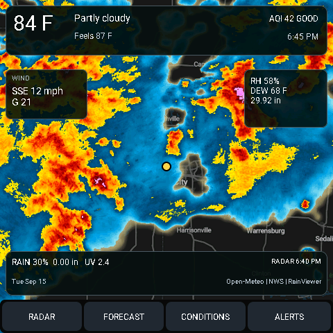
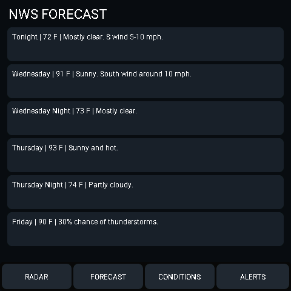
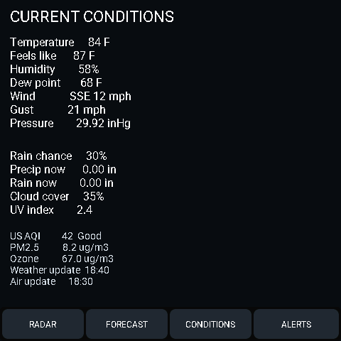

# ESP32-S3-4848S040 Weather & Radar Panel

A standalone, touchscreen weather station for the **ESP32-S3-4848S040 480×480 display**. Built with [ESPHome](https://esphome.io/) and [LVGL](https://lvgl.io/), it displays current weather, a four-frame animated precipitation radar, National Weather Service forecasts and alerts, and air quality.

**No Home Assistant, Raspberry Pi, proxy, or always-on server is required.** The panel fetches weather data directly over Wi-Fi. MQTT is configured in the example but is optional.

## Screenshots

These are **480×480 simulator renders**, not photographs of the physical panel. The simulator uses fixture weather values; its map/radar assets and location may differ from the device configuration.

| Radar | Forecast |
|:---:|:---:|
|  |  |
| Conditions | Alerts |
|  |  |

## Features

- **Radar:** Dark RainViewer basemap with four recent historical radar frames, animated on a 2.4-second loop. A marker identifies the configured location. Radar is historical imagery, **not a future forecast**.
- **Current conditions:** Temperature, feels-like temperature, wind and gusts, humidity, dew point, pressure, cloud cover, precipitation, and UV index.
- **Air quality:** US AQI, PM2.5, and ozone from Open-Meteo's air-quality API.
- **NWS forecast:** Up to six forecast periods, including temperature, short description, and precipitation probability when available.
- **NWS alerts:** Active alert count and details, with a radar-page alert button when alerts are present.
- **Touch navigation:** Four pages — Radar, Forecast, Conditions, Alerts.
- **Clock and power management:** SNTP clock in the configured timezone; backlight dims after one minute without LVGL activity and turns off after ten minutes. Touch wakes the backlight.
- **Fault-aware radar loading:** Frame downloads are serialized. The LVGL animation is assigned its online image sources only after all four downloads succeed, avoiding attempts to animate uninitialized image descriptors.

## Hardware

Designed for the **ESP32-S3-4848S040** board with these components:

| Component | Configuration |
|---|---|
| MCU | ESP32-S3 |
| Display | 480×480 RGB, ST7701S controller |
| Touch | GT911 over I²C |
| Flash | 16 MB |
| PSRAM | Octal, 80 MHz |
| Firmware | ESP-IDF through ESPHome |
| Display backlight | LEDC PWM on GPIO38 |

The display/touch pins in [`panel.yaml`](panel.yaml) are board-specific. Key assignments:

| Function | GPIO |
|---|---|
| Touch SDA / SCL | 19 / 45 |
| LCD SPI clock / MOSI / CS | 48 / 47 / 39 |
| LCD DE / HSYNC / VSYNC / PCLK | 18 / 16 / 17 / 21 |
| RGB red | 11, 12, 13, 14, 0 |
| RGB green | 8, 20, 3, 46, 9, 10 |
| RGB blue | 4, 5, 6, 7, 15 |

Do not assume these pins apply to other ESP32-S3 480×480 boards.

## Getting started

### 1. Install ESPHome

Install the [ESPHome command-line tools](https://esphome.io/guides/installing_esphome/) using your preferred method. For example, with `pipx`:

```bash
pipx install esphome
```

The physical configuration uses the older ESPHome `image:` / `online_image:` schema. If your installed ESPHome version rejects those options, use a compatible release or migrate the image configuration before flashing. The separate screenshot workflow pins ESPHome **2026.8.2 for its host simulator**; that does not independently verify the physical firmware configuration.

### 2. Clone and configure

```bash
git clone https://github.com/voidnullvalue/ESP32-S3-4848S040-480x480.git
cd ESP32-S3-4848S040-480x480
```

Edit [`panel.yaml`](panel.yaml):

- Set `wifi.ssid`, `wifi.password`, and the fallback access-point password. The checked-in strings are placeholders.
- Set `latitude` and `longitude` under `substitutions` for your location.
- Set `nws_latitude` and `nws_longitude` to the same coordinates rounded to four decimal places for the NWS endpoints.
- Update `time.timezone` and `http_request.useragent` as appropriate.
- Set the `mqtt.broker` address for your network, or remove the entire `mqtt:` block if you do not use MQTT.

For example:

```yaml
substitutions:
  latitude: "32.895424"
  longitude: "-96.618375"
  nws_latitude: "32.8954"
  nws_longitude: "-96.6184"
  location_name: "GARLAND"
  radar_zoom: "7"
  basemap_zoom: "7"
  radar_color: "2"
```

**Keep `radar_zoom` and `basemap_zoom` equal.** The map and radar use the same Web Mercator zoom semantics; differing zoom values misalign the precipitation overlay.

For a private configuration, consider replacing Wi-Fi credentials with ESPHome `!secret` references and keeping `secrets.yaml` out of Git. Never commit actual Wi-Fi or MQTT credentials.

### 3. Validate and flash

```bash
esphome config panel.yaml
esphome run panel.yaml
```

For the initial flash, connect the board via USB and select the appropriate serial port when prompted. Once the device is on Wi-Fi, subsequent updates can use ESPHome OTA where network discovery/connectivity permits.

For serial logs:

```bash
esphome logs panel.yaml
```

The first build needs internet access to fetch dependencies, Google Fonts, and the **compile-time RainViewer basemap**. After boot, live data and radar still require internet access; this is not an offline weather receiver.

## Data sources and refresh rates

| Data | Provider | Refresh |
|---|---|---|
| Current conditions | [Open-Meteo](https://open-meteo.com/) | 10 minutes |
| AQI / PM2.5 / ozone / UV | [Open-Meteo Air Quality](https://open-meteo.com/en/docs/air-quality-api) | 15 minutes |
| Forecast | [National Weather Service](https://www.weather.gov/documentation/services-web-api) | 30 minutes |
| Active alerts | [National Weather Service](https://www.weather.gov/documentation/services-web-api) | 2 minutes |
| Historical radar frames | [RainViewer](https://www.rainviewer.com/api.html) | 5 minutes |
| NWS forecast-grid URL | NWS `/points` endpoint | Resolved on startup and again every 6 hours |

The NWS endpoints are specific to US locations. Other locations need an alternative forecast/alert source or changes to those pages. Rates above describe the configured scheduling; network failures, retries, and API availability can affect when data actually updates.

Runtime network access includes `api.open-meteo.com`, `air-quality-api.open-meteo.com`, `api.weather.gov`, `api.rainviewer.com`, RainViewer's tile host, and an NTP server. HTTPS certificate validation is enabled, and the panel waits for a valid SNTP clock before starting its initial API requests.

## MQTT and Home Assistant

This project intentionally has **no ESPHome native `api:` component** and does not depend on Home Assistant.

The checked-in configuration includes an MQTT client with discovery disabled and `reboot_timeout: 0s`. MQTT is **not required for the display's weather data**; you can remove that block if you want the unit to rely solely on Wi-Fi and public weather APIs. If you retain it, replace the example broker IP with your own broker address.

## Radar implementation

RainViewer's public metadata endpoint supplies the available historical frame paths. The panel selects the latest four, creates their centered 512-pixel radar image URLs, and requests them sequentially.

The map is embedded in the firmware at compile time. Online radar frames are decoded into RGB565 images at 480×480. During a refresh, the existing animation is stopped and hidden, the success mask is reset, and new image buffers are downloaded. LVGL is given the four new sources only when the success mask confirms all downloads. If any frame fails, the UI displays a radar update error instead of starting an animation with an invalid source.

Four 480×480 RGB565 images require approximately **1.76 MiB** for the pixel data alone (before transparency, other image buffers, LVGL, and networking overhead). Working PSRAM is important.

## Simulator and screenshots

The repository also contains a host/SDL LVGL simulator:

- [`simulator/simulator.yaml`](simulator/simulator.yaml) — similar four-page layout with deterministic sample weather/alert data.
- [`.github/workflows/render-screenshots.yml`](.github/workflows/render-screenshots.yml) — builds the simulator and generates screenshot files.
- [`docs/screenshots/`](docs/screenshots/) — the images shown above.

To regenerate screenshots, run the **Render LVGL screenshots** workflow manually in GitHub Actions, or change the simulator/workflow paths that trigger it. The workflow retrieves map/radar assets, runs the simulator in a virtual X display, captures all four pages, and commits changed screenshots. Its simulated location and values are independent from the live physical panel.

## Troubleshooting

| Symptom | What to check |
|---|---|
| `lv_image_set_src: failed to get image info` | Make sure the `animimg` starts with a valid embedded image and that the four online images are only attached after successful downloads. Check the radar download error logs. |
| Radar shows `RADAR UPDATE ERROR` | Check internet/DNS/HTTPS access, RainViewer metadata, image URLs, and available PSRAM. One failed frame prevents the new animation set from being activated. |
| Radar appears geographically offset | Ensure `basemap_zoom` and `radar_zoom` match and latitude/longitude substitutions are correct. |
| Forecast missing | Check NWS `/points` resolution, forecast HTTP status, TLS, and whether the location is covered by NWS. |
| Clock missing or HTTPS failures on startup | Check Wi-Fi, DNS, and SNTP time synchronization; TLS validation needs a correct clock. |
| Device reports allocation/decoding errors | Check octal PSRAM settings, memory usage, and downloaded image formats. |
| Touch or screen not working | Confirm the exact board revision and the ST7701S, GT911, RGB, SPI, and backlight GPIO assignments. |
| `esphome config` fails on image options | The device YAML uses a legacy image schema; check ESPHome version compatibility before changing unrelated hardware pins. |

Use `esphome logs panel.yaml` to inspect request status, connection errors, and LVGL/image decoder warnings.

## Repository contents

```text
.
├── panel.yaml                            # Physical ESP32-S3 firmware
├── simulator/
│   └── simulator.yaml                    # Host/SDL documentation simulator
├── docs/
│   └── screenshots/                      # Rendered four-page previews
├── .github/workflows/
│   └── render-screenshots.yml            # Screenshot generator
└── LICENSE
```

## License

[GNU General Public License v3.0](LICENSE).
